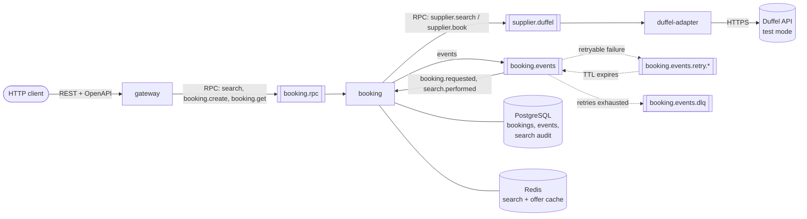

# Flight Booking Service

A personal learning project. It searches and books **flights** through the Duffel Flights API and exposes it as a small set of NestJS microservices that
talk over RabbitMQ.

> **This is a personal learning project built against the supplier's sandbox.** It runs only
> against the [Duffel Flights API](https://duffel.com/docs/api) (v2, test mode) using my own developer account. It is not a commercial product and has never
> made a real booking. Booking calls refuse to run against live credentials unless
> `ALLOW_LIVE_BOOKINGS=true` is set.

It is one of three sibling projects with the same architecture, one per travel API:

- **flight-booking-service** (this repository): flights through Duffel
- [transfer-booking-service](https://github.com/malikshoaib715/transfer-booking-service): airport transfers through Hotelbeds Transfers
- [excursions-service](https://github.com/malikshoaib715/excursions-service): excursions and tours through Hotelbeds Activities

## Architecture



| Service | Role |
| --- | --- |
| `gateway` | Public REST API with request validation, URI versioning and Swagger at `/docs`. Holds no state; calls the booking service over RabbitMQ request/reply. |
| `booking` | Owns search caching (Redis), the booking lifecycle (PostgreSQL) and the search audit. Calls the supplier adapter over RabbitMQ and consumes the booking events. |
| `duffel-adapter` | Calls Duffel: `POST /air/offer_requests` for search and `POST /air/orders` (instant order paid from the test balance) for booking. Maps both onto the normalised model. |
| `libs/contracts` | The normalised model and message contracts. `model.ts` and `messages.ts` are supplier-agnostic; `product.ts` holds the product-specific types. |
| `libs/common` | Supplier HTTP wrapper, RabbitMQ options and the retry / dead-letter helpers. |

### Normalised model

The adapter maps Duffel's wire format onto one supplier-agnostic `Offer`, so the gateway and
booking service never handle supplier JSON:

```ts
interface Offer {
  id: string;                    // deterministic per supplier offer
  supplier: Supplier;
  productType: ProductType;
  title: string;
  price: { amount: string; currency: string };  // decimal string, never a float
  expiresAt: string | null;
  refundable: boolean | null;    // null = the supplier did not say
  cancellationPolicies: { from: string; penalty: Money }[];
  details: OfferDetails;         // product-specific, defined in product.ts
  supplierContext: Record<string, unknown>;  // supplier ids / rate keys; never leaves the backend
}
```

| Duffel | Normalised |
| --- | --- |
| `offer.id`, `total_amount`, `total_currency` | `supplierContext.offerId`, `price` (2dp decimal string) |
| `expires_at` | `expiresAt`; the offer is never cached beyond it |
| `conditions.refund_before_departure` | `refundable`, `cancellationPolicies` |
| `slices[].segments[]` | `details.slices[].segments[]` with marketing **and operating** carrier |
| `passengers[].id` | kept in `supplierContext` and matched to travellers at booking time |

### Messaging

- **Search is request/reply.** The gateway sends `search.execute` to the booking service. On a
  cache miss, the booking service sends `supplier.search` to the adapter, with a deadline. A supplier
  failure or timeout comes back as `status: "ERROR" | "TIMEOUT"` with an `error` object, not as an
  HTTP error, so callers can tell "no availability" apart from "supplier down". RPC queues carry a
  message TTL so stale requests are dropped rather than processed late.
- **Booking is event driven.** `POST /v1/bookings` checks the request against the cached offer,
  stores the booking as `PENDING`, publishes `booking.requested` and returns `202` at once. A
  worker consumes the event with manual acks and calls the adapter. It records `CONFIRMED` or
  `FAILED` and publishes `booking.confirmed` or `booking.failed`.
- **Retries and the dead-letter queue.** When a booking attempt fails in a way that is safe to
  repeat (HTTP 429/503, connection refused, or our own database being down), the message moves to a
  retry queue for that delay (`booking.events.retry.5000ms`, `…20000ms`, `…60000ms` by default).
  When the TTL expires, the broker dead-letters it back to the work queue. Once the attempts run
  out, the message is rejected into `booking.events.dlq` and the booking is marked `FAILED` with
  `RETRIES_EXHAUSTED`. This works on stock RabbitMQ, with no delayed-message plugin.
- **No blind retries of bookings.** A timeout or dropped connection during a booking call is *not*
  retried, because the supplier may already have created the booking. Such bookings fail with a
  code that tells you to reconcile them by hand. Redelivered events are ignored once a booking has
  left `PENDING`, and an `Idempotency-Key` header makes client retries of `POST /v1/bookings` safe.

### Storage

- **PostgreSQL** (TypeORM, migrations run on start): `bookings` (with a snapshot of the offer as
  searched), `booking_events` (lifecycle history), and `search_audit` (one row per search, written
  asynchronously from the `search.performed` event so it never slows a search).
- **Redis**: the search result keyed by a hash of the criteria (`SEARCH_CACHE_TTL_SECONDS`), plus
  each offer by id so a booking can find it later. An offer is never cached past the supplier's own
  expiry. If Redis is down, searches still work but are not cached.

## Sandbox account

1. Sign up at [app.duffel.com](https://app.duffel.com).
2. Switch the dashboard to **test mode** and open **More → Developers → Access tokens**.
3. Create a token. Test tokens start with `duffel_test_`. Put it in `.env` as `DUFFEL_ACCESS_TOKEN`.

Test mode returns offers from *Duffel Airways* (IATA `ZZ`), a fictional airline with unrealistic
schedules and prices. Orders are paid from the test balance, so no card is needed.

## Running it

Requirements: Docker with Compose v2. Node 22+ is only needed to run the tests or scripts on the host.

```bash
cp .env.example .env      # then add your sandbox credentials
docker compose up --build
```

| URL | What |
| --- | --- |
| http://localhost:8081/docs | Swagger UI / OpenAPI |
| http://localhost:8081/health | Liveness |
| http://localhost:15673 | RabbitMQ management (guest / guest): queues, retry queues, DLQ |

The default ports differ between the three sibling projects, so all three can run at once.

Check the supplier connection end to end:

```bash
npm run smoke              # one search through the gateway
npm run smoke -- --book    # also books the cheapest offer and waits for the outcome
```

Without credentials the stack still starts, and searches return `status: "ERROR"` with
`NOT_CONFIGURED`.

### Development

```bash
npm ci
npm run lint && npm run typecheck && npm test
npm run fixtures:record   # refresh the adapter fixture from the live sandbox (reads .env)
```

The adapter tests run the mapping logic against JSON fixtures in
`apps/duffel-adapter/test/fixtures`. The fixture in the repository follows the response format in
Duffel's API documentation. `npm run fixtures:record` replaces it with a real sandbox response;
after recording, update any test expectations that check specific values.

## Example requests

The responses are abbreviated, and their values are examples.

### Search

```bash
curl -s localhost:8081/v1/search -H 'content-type: application/json' -d '{
  "criteria": { "origin": "LHR", "destination": "BCN", "departureDate": "2027-03-12", "returnDate": "2027-03-19" },
  "travellers": { "adults": 1, "childAges": [7] }
}'
```

```jsonc
{
  "searchId": "c4a747b1-541e-4b20-8b45-6209764f1ccb",
  "supplier": "DUFFEL",
  "productType": "FLIGHT",
  "status": "OK",
  "cached": false,
  "tookMs": 840,
  "offers": [
    {
      "id": "dfl_f2d2921437e6af8beade3e47",
      "supplier": "DUFFEL",
      "productType": "FLIGHT",
      "title": "Duffel Airways: LHR to BCN (return)",
      "price": { "amount": "268.14", "currency": "GBP" },
      "expiresAt": "2027-01-15T18:32:11.482Z",
      "refundable": false,
      "cancellationPolicies": [],
      "details": {
        "kind": "FLIGHT",
        "airline": { "name": "Duffel Airways", "iataCode": "ZZ" },
        "stops": 0,
        "slices": [{ "origin": "LHR", "destination": "BCN", "duration": "PT2H5M", "segments": [ /* … */ ] }]
      }
    }
  ]
}
```

### Book an offer

```bash
curl -s localhost:8081/v1/bookings -H 'content-type: application/json' \
  -H 'Idempotency-Key: 6f1c0a52-booking-1' -d '{
  "offerId": "dfl_f2d2921437e6af8beade3e47",
  "contact": { "email": "traveller@example.com", "phone": "+442080160508" },
  "travellers": [
    { "type": "ADULT", "title": "ms", "givenName": "Amelia", "familyName": "Earhart",
      "dateOfBirth": "1987-07-24", "gender": "f" }
  ]
}'
# 202 {"id":"967a418e-…","status":"PENDING", …}
```

```bash
curl -s localhost:8081/v1/bookings/967a418e-5e81-4486-910c-7d9cacd90ccb
```

```jsonc
{
  "id": "967a418e-5e81-4486-910c-7d9cacd90ccb",
  "status": "CONFIRMED",
  "supplierReference": "RZPNX8",
  "attempts": 2,
  "events": [
    { "type": "REQUESTED" },
    { "type": "ATTEMPT_FAILED", "detail": { "attempt": 1, "code": "SUPPLIER_HTTP_503", "retryInMs": 5000 } },
    { "type": "CONFIRMED", "detail": { "attempt": 2, "supplierReference": "RZPNX8" } }
  ]
}
```

| Status | When |
| --- | --- |
| `400` | Request body fails validation |
| `404` | Offer unknown or expired: search again |
| `422` | Booking does not fit the offer (for example, no adult traveller) |
| `503` / `504` | Booking service unavailable or did not answer in time |

### Duffel specifics

- Travellers on the booking must match the passenger mix the offer was priced for (adults
  versus children by age). A mismatch fails the booking with `VALIDATION` rather than calling Duffel.
- Lap infants (age 0–1) are attached to a distinct adult with `infant_passenger_id`.
- Duffel asks clients to wait at least 130 s for order creation, so the adapter uses that timeout
  and never retries a booking call that timed out.

## Configuration

See [`.env.example`](.env.example).

| Variable | Default | |
| --- | --- | --- |
| `SUPPLIER_SEARCH_TIMEOUT_MS` | `20000` | Supplier search deadline |
| `SEARCH_CACHE_TTL_SECONDS` | `120` | How long a search result is served from Redis |
| `OFFER_TTL_SECONDS` | `1800` | Upper bound for keeping an offer bookable |
| `MAX_OFFERS_PER_SUPPLIER` | `20` | Cheapest N offers returned |
| `BOOKING_RETRY_DELAYS_MS` | `5000,20000,60000` | Backoff schedule; one retry queue per value |

## Known limitations

- Payments are out of scope. Duffel orders are paid from the test account balance.
- Bookings whose supplier call timed out are marked failed for manual reconciliation. Nothing
  automatically checks the supplier's booking list.
- No authentication, rate limiting or tracing. A real deployment would add them at the gateway.

## Licence

MIT
